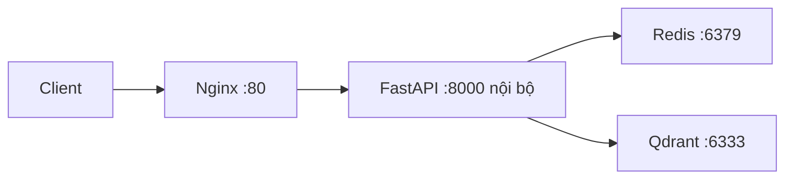

# Day 14 — Mission Answers

Bài làm dùng mock LLM và số đo từ chính các lệnh đã chạy. Thông tin hệ thống/lần đo: `reports/benchmark-run.json`. Agent đã deploy Render, có bốn kết quả kiểm tra public; xem `DEPLOYMENT.md` và `reports/public-deployment.json`. Đã có `screenshots/running.png` và `screenshots/test.png`; còn ảnh tổng quan service `screenshots/dashboard.png`. Hướng dẫn tái chạy: `RUN_LAB.md`.

## Part 1 — Localhost vs Production

### Exercise 1.1 — Anti-patterns

1. `develop/app.py:17–18`: API key giả lập và thông tin kết nối DB ghi trong source. Cách này làm lộ secret qua repo/lịch sử commit; bản hoàn thiện dùng env vars.
2. Dòng 34: in API key ra log. Ai đọc log cũng có thể lấy credential; không ghi secret vào log.
3. Dòng 21 và 53: bật debug/reload. Reload chỉ phục vụ dev, có thể khởi động lại process khi source đổi.
4. Dòng 52: port 8000 cố định, không nhận PORT từ nền tảng.
5. Dòng 51: bind localhost, không nhận kết nối từ ngoài container.
6. Không có `/health` và `/ready`: nền tảng không phân biệt process chết với dependency chưa sẵn sàng.
7. Không có lifecycle cleanup: tắt service dễ cắt ngang request hoặc để tài nguyên chưa dọn.
8. Dùng print rời rạc, thiếu cấu trúc và correlation ID nên khó tìm nguyên nhân lỗi.

### Exercise 1.2 — Gọi bản develop

Đã chạy app bằng uvicorn ở port 18101 để cô lập các ví dụ; POST `/ask?question=Hello` trả 200. Bản này nhận query parameter, không nhận body JSON. Output HTTP thật: [cp1-develop-http.txt](reports/cp1-develop-http.txt). Bản production nhận JSON và trả 200: [cp1-production-http.txt](reports/cp1-production-http.txt).

### Exercise 1.3 — So sánh

| Feature | Develop | Production example | Vì sao cần |
|---|---|---|---|
| Config | Giá trị cố định trong app | Settings đọc env | Cùng source dùng cho nhiều môi trường |
| Host/port | localhost:8000 | 0.0.0.0 và PORT | Truy cập được trong container/cloud |
| Health/readiness | Không có | Có hai endpoint | Phân biệt sống và sẵn sàng |
| Log | print, lộ key | Logging với định dạng JSON | Thu thập/lọc tập trung |
| Shutdown | Không quản lý lifecycle | Lifespan startup/shutdown | Dọn tài nguyên khi tắt |
| Reload | Bật | Theo config debug | Không tự reload production |

Ví dụ sửa cụ thể: bản develop dòng 52 cố định port; bản production đọc `settings.port` từ config env. Lưu ý formatter JSON bằng chuỗi trong ví dụ mẫu không escape message an toàn; Part 6 đã dùng `json.dumps` cho từng record để bảo đảm JSON hợp lệ.

## Part 2 — Docker

### Exercise 2.1 — Bốn câu hỏi

1. Base image `python:3.11` cung cấp Python runtime và hệ điều hành nền cho stage đầu. Bản nâng cao dùng `python:3.11-slim`.
2. `WORKDIR /app` đặt thư mục làm việc cho COPY/RUN/CMD tiếp theo, giảm phụ thuộc đường dẫn tuyệt đối.
3. Copy requirements trước và cài dependencies, rồi mới copy source: sửa code không làm invalid cache của layer cài dependencies nếu requirements không đổi.
4. ENTRYPOINT xác định chương trình chính; CMD cung cấp lệnh mặc định hoặc đối số mặc định. Đối số sau tên image thay CMD; đổi ENTRYPOINT cần `--entrypoint`. Exec form giúp chương trình nhận signal trực tiếp; nếu dùng shell phải `exec` chương trình chính.

### Exercise 2.2 — Build/run

Build từ gốc repo với hai Dockerfile của Part 2. Container develop ở localhost:18000 nhận POST query và trả 200: [cp2-container-http.txt](reports/cp2-container-http.txt). Log build ở `reports/docker-develop-build.txt` và `reports/docker-advanced-build.txt`.

### Exercise 2.3 — Multi-stage và dung lượng

Builder cài gcc/libpq-dev và dependencies. Runtime chỉ nhận Python slim, dependencies và code; không mang compiler và build tools vào image cuối. Kết quả `docker image inspect .Size` (bytes), đổi sang MiB bằng chia 1024²:

| Image | Bytes | MiB |
|---|---:|---:|
| Develop | 415378539 | 396.14 |
| Advanced | 57515571 | 54.85 |

Giảm **86.15%** so với develop. Dữ liệu gốc: [docker-image-sizes.json](reports/docker-image-sizes.json).

### Exercise 2.4 — Compose stack



Redis phục vụ state/cache, Qdrant là vector database trong stack mẫu; Nginx proxy và áp dụng rate limit theo IP. Các service giao tiếp bằng DNS service name trên bridge network. Volume tách dữ liệu khỏi vòng đời container. Đã tạo `.env.local` bị ignore, chạy project `k5-day14-docker`, kiểm HTTP 200 qua Nginx và dừng stack. Output: [cp2-nginx-http.txt](reports/cp2-nginx-http.txt).

## Part 3 — Cloud Deployment

**Trạng thái:** agent Part 6 đã chạy trên [Render](https://k5-l3b-day14-nguyendinhminh-2a202603867.onrender.com). GET /health và /ready trả 200; POST /ask thiếu key trả 401 (assistant kiểm tra trực tiếp). Chủ repo đã chạy Swagger có key trả 200, có answer và usage, lúc 15:04:58 GMT+7 ngày 26/11/2026. Kết quả đã bỏ secret trong [public-deployment.json](reports/public-deployment.json). Ảnh Render Live/log và Postman 200 đã lưu ở `screenshots/running.png`, `screenshots/test.png`; còn ảnh tổng quan service `screenshots/dashboard.png` để đủ bằng chứng CP6.

Railway TOML mô tả build/deploy của một service, healthcheckPath và restart policy; Render YAML Blueprint mô tả danh sách service, rootDir, Docker context và envVars. Cả hai đều cần Redis URL, API key và app nhận PORT động. Secret dùng generateValue/sync:false trên Render hoặc platform variables trên Railway.

Cloud Run CI/CD trong mẫu: (1) chạy pytest; (2) build Docker image tag commit và latest; (3) push registry; (4) deploy image lên Cloud Run. `service.yaml` mô tả tài nguyên, concurrency, min/max replica, timeout, secret và probes. Theo K5 chỉ đọc pipeline, không triển khai GCP.

Chi tiết và chỗ điền URL: [DEPLOYMENT.md](DEPLOYMENT.md).

## Part 4 — API Security

### Exercise 4.1 — API key

FastAPI dependency đọc `X-API-Key` và đối chiếu key từ env. Không có key trả 401, có key trả 200. Rotate bằng đổi secret ở môi trường rồi restart/redeploy service; không sửa source. Đã chạy key ngẫu nhiên trong env, không lưu credential trong evidence: [cp3-api-key-http.txt](reports/cp3-api-key-http.txt).

### Exercise 4.2 — JWT

Đã POST `/auth/token` với tài khoản demo student, lấy token rồi gửi `Authorization: Bearer ...`. JWT chứa sub/role/iat/exp, có chữ ký để phát hiện sửa payload; payload không mặc nhiên được mã hóa. Server xác minh chữ ký và hạn dùng. Token hết hạn phải đăng nhập lại. Không lưu token trong bài.

### Exercise 4.3 — Rate limit

Bản mẫu dùng deque timestamp theo user, loại timestamp cũ hơn 60 giây rồi đếm số request trong cửa sổ; user 10 request/phút, admin 100 request/phút. Admin được quota cao hơn, không phải bỏ giới hạn hoàn toàn. Trong lần chạy, request 1–10 của student trả 200, request 11–12 trả 429 kèm Retry-After. Output nguyên response HTTP, không token: [cp3-jwt-rate-http.txt](reports/cp3-jwt-rate-http.txt).

RAM riêng cho mỗi process làm quota sai khi scale/restart; Part 6 dùng Redis sorted set và Lua để prune/check/add/expire nguyên tử, dùng Redis TIME thay vì đồng hồ riêng từng worker.

### Exercise 4.4 — Cost guard

Cần rate limit và cost guard vì request ít vẫn có thể tốn nhiều token. Chi phí mô phỏng = input_tokens/1000 × giá input + output_tokens/1000 × giá output. Ví dụ Part 4 cộng dồn theo user trong RAM; nếu mở rộng phải chuyển state sang Redis và khóa theo kỳ ngân sách.

Part 6 đã làm Redis theo ngày UTC, đọc DAILY_BUDGET_USD, reserve chi phí trước khi gọi mock bằng Lua, rồi đối soát usage thực tế. Không đủ budget trả 402. Reset bằng key theo ngày, TTL dọn key cũ. Reservation tránh nhiều worker cùng dùng phần ngân sách còn lại; rate-limit và ledger key dùng hash API key để không lưu raw credential.

## Part 5 — Scaling & Reliability

### Exercise 5.1 — Liveness/readiness

Liveness `/health` nói process còn sống; readiness `/ready` nói instance đủ điều kiện phục vụ, ví dụ Redis có kết nối. Dependency hỏng phải giảm readiness, không làm liveness hỏng để tránh restart loop. Part 6 đã được script chấm xác minh khi Redis down: health 200, ready 503.

### Exercise 5.2 — Graceful shutdown

Đã phát request rồi gửi SIGTERM, request vẫn trả 200: [cp4-graceful-http.txt](reports/cp4-graceful-http.txt). Phát hiện handler đăng ký lúc import trong ví dụ Part 5 nuốt SIGTERM khi dùng uvicorn CLI; đã bỏ đăng ký và để uvicorn drain request. Process ví dụ một worker exit theo signal (-15); Part 6 với hai worker trong phép chấm exit 0, Docker stop 1.0 giây (xem readiness report).

### Exercise 5.3–5.5 — Stateless và load balancing

State trong RAM bị tách theo process và mất khi restart; lưu history trong Redis giúp request đi qua instance khác vẫn đọc cùng session. Đã chạy `--scale agent=3`, Nginx cổng 8080, endpoint `/chat`. Script gửi 5 câu đi qua cả 3 instance và history còn đầy đủ **10 messages** (5 user + 5 assistant). Output: [cp4-stateless.txt](reports/cp4-stateless.txt). Script không tự kill instance; thí nghiệm pause instance thực hiện ở Part 7.

## Part 6 — Final project

Đã hoàn thiện code trong `06-lab-complete/`. Agent chạy nhiều worker, auth/rate limit/cost guard, JSON log, Redis state, liveness/readiness, graceful shutdown, multi-stage Docker và config deploy. Docker image của bài chấm đo 63 MiB; không dùng số dung lượng Part 2 thay cho Part 6.

Kiểm tra đầy đủ có Docker: [production-readiness.txt](reports/production-readiness.txt).

```text
  📋 Checklist Deliverable
     ✅ Dockerfile (multi-stage, < 500 MB)
     ✅ docker-compose.yml (agent + redis)
     ✅ .dockerignore
     ✅ Health check endpoint (GET /health)
     ✅ Readiness endpoint (GET /ready)
     ✅ API Key authentication
     ✅ Rate limiting
     ✅ Cost guard
     ✅ Config từ environment variables
     ✅ Structured logging
     ✅ Graceful shutdown
     ✅ Public URL ready (Railway / Render config)
----------------------------------------------------------------
  Result: 12/12 tiêu chí đạt · 43/43 checks passed
  🎉 PASS 12/12 — PRODUCTION READY! Deploy nào!
================================================================

```

`Public URL ready` của script chấm kiểm file cấu hình và PORT; việc deploy thật được kiểm chứng riêng bằng bốn kết quả trong `reports/public-deployment.json`. Bốn kiểm thử bổ sung trên Redis thật: [guard-integration-tests.txt](reports/guard-integration-tests.txt).

## Part 7 — Benchmark & Observability

Báo cáo riêng: [BENCHMARK_REPORT.md](BENCHMARK_REPORT.md), JSON trong `reports/`, CSV trong `benchmark-results/`, ảnh trong `screenshots/`. Mọi số lấy từ chạy thật; không sửa script chấm hoặc golden dataset.

## AI log

| Yêu cầu | AI cung cấp/thực hiện | Kiểm chứng và phần chủ repo còn cần làm |
|---|---|---|
| Giải thích Day14 | Đọc repo, diễn giải lý thuyết/checkpoints/cấu hình | Đối chiếu README, CHECKPOINTS, RUBRIC và code |
| Triển khai toàn bộ lab, Render làm sau | AI viết code Part 6, sửa KB, scripts, CI, tài liệu và chạy lab local | Script chấm 12/12, test Redis đồng thời, load test/eval, Docker scaling, promtool, trace và alert evidence; chủ repo cần đọc/giải thích lại code và số đo |
| Deploy cloud | AI chuẩn bị config và hướng dẫn; chủ repo tự tạo Redis/Web Service trên Render và chạy Swagger có key | AI kiểm tra health/ready/401, lưu kết quả 200 do chủ repo cung cấp sau khi loại secret; chủ repo đã cung cấp ảnh Live/log và Postman 200; còn ảnh tổng quan service |

Đây là bài triển khai có AI hỗ trợ; không khai chủ repo đã tự viết hoặc tự kiểm những phần do AI thực hiện. Lần đo local do AI điều khiển công cụ trên máy chủ repo. Cần khai báo lại nếu có thay đổi bằng AI ở các lần sau.
